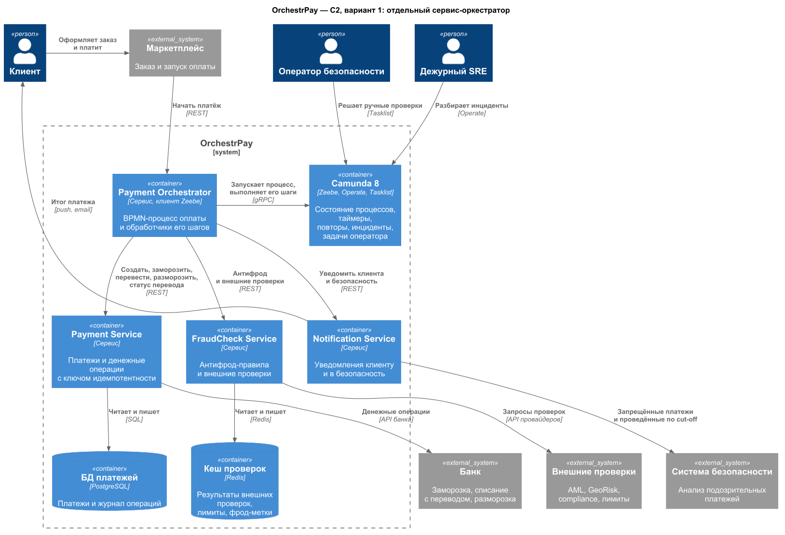
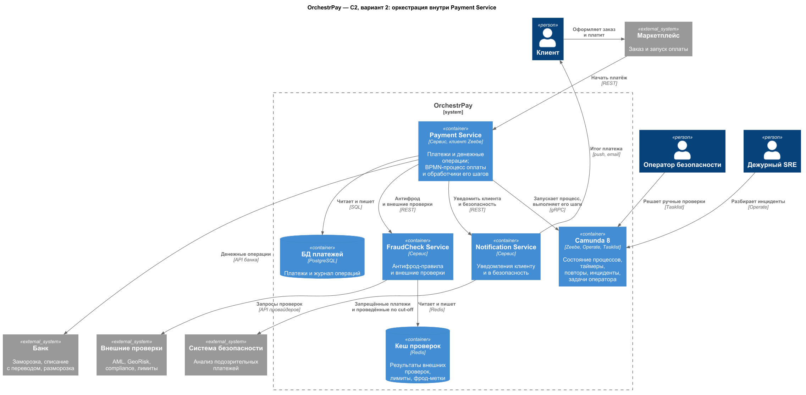

# ADR: где разместить оркестрацию платёжного процесса

## Общая информация

1. Родительский артефакт: [шаги Saga](../Task1/README.md), [таблица переходов](../Task2/README.md), [BPMN-процесс](../Task4.1/README.md)
2. Автор ADR: Святослав Рожков
3. Статус: Принят
4. Согласующие: отдел «Платёжные сервисы», команды «Безопасность» и «DevOps/SRE»

Вклад ИИ в подготовку: [AI-LOG](../AI-LOG.md).

## Контекст

Ключевой процесс OrchestrPay — оплата заказа на маркетплейсе. Деньги клиента замораживаются, затем параллельно идут антифрод и внешние проверки: AML, GeoRisk, лимиты. Если проверки разрешили платёж, замороженная сумма списывается и переводится продавцу. При запрете деньги размораживаются, а клиент и безопасность получают уведомления. Шаги и их типы описаны в [задании 1](../Task1/README.md).

В процессе участвуют Payment Service, FraudCheck Service с внешними провайдерами, Notification Service и оператор безопасности. Оператор решает до 20 минут, у автоматических проверок срок 3 секунды, после него действует cut-off. Успешный платёж должен проходить быстрее 5 секунд в 90% случаев. Бизнесу и безопасности нужно видеть, на каком шаге находится каждый платёж и где он остановился.

Команда выбрала Saga-оркестрацию. Тип саги — **Fairy Tale Saga**: оркестрация, синхронные вызовы участников и итоговая согласованность.

- Обработчики шагов вызывают FraudCheck Service, Notification Service и банк синхронно, с тайм-аутами и повторами. Такие вызовы проще отлаживать, а SLA в 5 секунд на них легко разложить по шагам.
- Глобальной транзакции нет: при отказе выполняются компенсации, и состояние сходится постепенно.
- Долгие ожидания, например решение оператора до 20 минут, держит движок, а не открытый вызов. Проверки идут в параллельных ветках, и это тоже работа движка.

Рассмотрены и другие типы:

- **Parallel Saga** с асинхронными командами через брокер. Ей нужны Kafka, outbox и inbox, а участники должны уметь отвечать событиями. Для MVP это лишняя инфраструктура, а выигрыш в пропускной способности сейчас не нужен.
- **Хореография** (Anthology Saga). Не подходит: процесс длинный и ветвистый, его состояние должно быть видно в одном месте, а команда уже выбрала оркестрацию.

Оркестратором будет Camunda 8. Она работает отдельно от сервисов и сама хранит состояние процессов, таймеры, повторы и инциденты. Operate показывает ход каждого платежа, в Tasklist оператор решает ручные проверки. Решить остаётся другое: где живут BPMN-схема процесса и обработчики его шагов, которые вызывают сервисы, — внутри Payment Service или в отдельном сервисе-оркестраторе.

## Рассмотренные варианты

### Вариант №1 «Отдельный сервис-оркестратор»

Новый сервис Payment Orchestrator разворачивает BPMN-процесс в Camunda и выполняет его шаги: забирает задачи у Zeebe и вызывает Payment Service, FraudCheck Service и Notification Service по их API. В нём только порядок шагов, сроки и компенсации, денежных операций и правил антифрода там нет. Payment Service выполняет денежные операции с ключом идемпотентности и хранит платежи в своей PostgreSQL.

Исходник: [c2-orchestrator-service.puml](c2-orchestrator-service.puml).

### Вариант №2 «Оркестрация внутри Payment Service»

Payment Service — владелец платежа — держит BPMN-процесс и обработчики его шагов. Денежные шаги выполняются внутри сервиса, к FraudCheck Service и Notification Service он обращается по их API. Эти сервисы о процессе не знают. Camunda, Operate и Tasklist те же, что в первом варианте.

Исходник: [c2-payment-service.puml](c2-payment-service.puml).

## Сравнение альтернатив

Прозрачность хода платежа, хранение состояния, таймеры, повторы и инциденты в обоих вариантах обеспечивает Camunda, поэтому по этим критериям варианты равны. Различаются они тем, где живёт код процесса.

| Вариант решения | Преимущества | Недостатки |
| :- | :- | :- |
| Вариант №1 «Отдельный сервис-оркестратор» | - Изменение процесса не требует выпуска Payment Service - Обращения к антифроду и уведомлениям не живут в сервисе, который двигает деньги - В этот же сервис можно сложить следующие процессы: отмену по инициативе клиента и возврат постфактум | - Ещё один сервис в разработке, выпуске и поддержке - Каждый денежный шаг — сетевой вызов Payment Service, на пути платежа на одно звено больше - Логика платежа делится между двумя сервисами и двумя командами |
| Вариант №2 «Оркестрация внутри Payment Service» | - Нет нового сервиса, меньше звеньев на пути денег - Денежные шаги выполняются внутри сервиса, без сетевых вызовов - Платёж и его процесс у одной команды | - Любое изменение процесса — выпуск сервиса, который двигает деньги - В Payment Service появляется код обращений к другим сервисам. С каждым новым процессом он растёт |

Был и третий путь: каждый сервис сам забирает из Camunda задачи своих шагов, а схему разворачивают отдельно. Он отвергнут. FraudCheck Service и Notification Service знали бы шаги и переменные платёжного процесса, и для нового процесса их пришлось бы дорабатывать. Без Camunda их было бы не вызвать, понадобился бы второй API. В варианте №2 от Camunda зависит только Payment Service, а остальные сервисы вызываются через свой API, кто бы их ни вызывал.

## Принятое решение

Выбран **вариант №2 «Оркестрация внутри Payment Service»**.

Отдельный оркестратор обычно выбирают, если выполняются три условия из шести. У нас выполняются четыре, но все четыре закрывает сама Camunda, а она работает отдельно от сервисов в обоих вариантах:

| Условие в пользу отдельного оркестратора | Выполняется | Чем закрыто |
| :- | :- | :- |
| В процессе три и более сервисов | да | Порядок вызовов и состояние хранит Camunda |
| Много разветвлённых веток | да | Ветки, таймеры и компенсации описаны в BPMN-схеме и исполняются движком |
| Нужны аудит, наглядность хода процесса, действия оператора | да | Operate показывает ход каждого платежа, оператор работает в Tasklist |
| Есть принятый движок для саги | да | Camunda 8 |
| Процесс используется несколькими доменами | нет | Процесс оплаты принадлежит платежам |
| Частые изменения сценариев и эксперименты | частично | Проверки и сроки меняются, но версии схемы ведёт Camunda: начатые платежи доходят по своей версии |

Встроенную оркестрацию обычно выбирают при других условиях:

| Условие в пользу оркестрации внутри доменного сервиса | Выполняется |
| :- | :- |
| Сценарий линейный, из двух-трёх шагов, отказы редки, компенсации простые | нет: шагов больше десяти, есть развилки и неопределённость ответов |
| Жёсткие требования к задержке | да: 5 секунд на платёж, из них 3 секунды уходят на проверки |
| Зрелая команда домена умеет повторы, идемпотентность и дедупликацию | да: команда платежей отвечает за денежные операции с ключами идемпотентности |
| Процесс уникален для домена и редко меняется | частично: процесс оплаты принадлежит платежам, но проверки и сроки в нём меняются |

По этим условиям вариант №2 не очевиден: процесс сложный. Сложность процесса берёт на себя Camunda, поэтому первое условие не так важно, как было бы при самописной оркестрации. Сравнение сводится к тому, где живёт код вокруг движка. Отдельный сервис поверх Camunda дал бы только независимый выпуск процесса. Цена — лишний сервис и лишнее звено на пути денег.

Так же советуют в Camunda. Бернд Рюкер пишет, что моделью процесса владеет команда домена, и приводит именно этот пример: «Payment: This is owned by the payment microservice». Отдельный процесс-оркестратор он не выделяет и предостерегает от «BPM-монолита». Документация Camunda рекомендует держать весь код обработчиков в одном приложении, которое разворачивает схему, и выносить обработчики только ради отдельной нагрузки или другого языка.

Минусы варианта закрываются так:

- Код процесса — отдельный модуль Payment Service. Тест на ArchUnitNET запрещает денежному коду зависеть от клиента Camunda и от модуля процесса.
- Схема процесса и обработчики выпускаются вместе, в одном релизе Payment Service. Поэтому схема не окажется в Camunda раньше обработчиков своих шагов. В стенде задания схему разворачивает отдельный контейнер `deploy-process`, в рабочем контуре это делает конвейер выпуска Payment Service.
- FraudCheck Service и Notification Service остаются сервисами со своим API и о процессе не знают.

Решение пересматривается, если в Payment Service появятся несколько процессов, которые меняют разные команды, или процессам понадобится отдельное масштабирование. Тогда процессы выносятся в отдельный сервис по варианту №1.

Источники:

- [Who owns your process model — Camunda blog](https://camunda.com/blog/2020/03/who-owns-your-process-model/)
- [The Microservices Workflow Automation Cheat Sheet](https://dev.to/berndruecker/the-microservice-workflow-automation-cheat-sheet-5f)
- [Writing good workers — Camunda docs](https://docs.camunda.io/docs/components/best-practices/development/writing-good-workers/)

## Недостатки, ограничения, риски

- SRE поддерживают Camunda: Zeebe, Operate, Tasklist и Elasticsearch. Если Zeebe недоступен, новые платежи не начинаются, а начатые продолжаются после восстановления с сохранённого шага. Доступность Zeebe и открытые инциденты мониторятся.
- Если обработчики Payment Service не работают, платежи ждут в Camunda. Срок проверок отсчитывает обработчик, поэтому простой обработчиков не превращается в одобрение по cut-off.
- Каждый шаг проходит через Zeebe, это добавляет задержку. В прототипе Camunda с обработчиками тратит на весь успешный путь около 0,3 секунды, на заморозку и перевод в банке остаётся больше секунды из бюджета SLA.
- Клиент Zeebe для .NET поддерживает сообщество, а не Camunda. Он стоит на денежном пути, поэтому версия клиента фиксируется и проверяется на стенде с той же версией Camunda.
- Сроки проверок и задача оператора безопасности описаны в схеме, которой владеет команда платежей. Изменения в них согласуются с командой «Безопасность».
- Если FraudCheck Service или Notification Service недоступен, шаг повторяется с паузами, а для проверок действует cut-off. Деньги до перевода остаются замороженными у клиента.
- Новая версия схемы действует для новых платежей, начатые доходят по своей версии. Удалять шаги, которых ждут начатые платежи, нельзя, пока те не завершатся.
