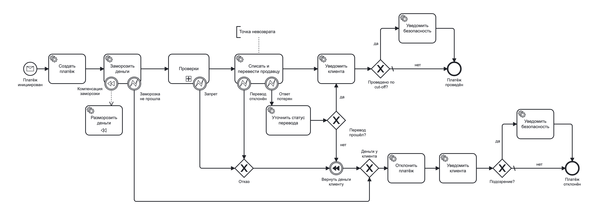
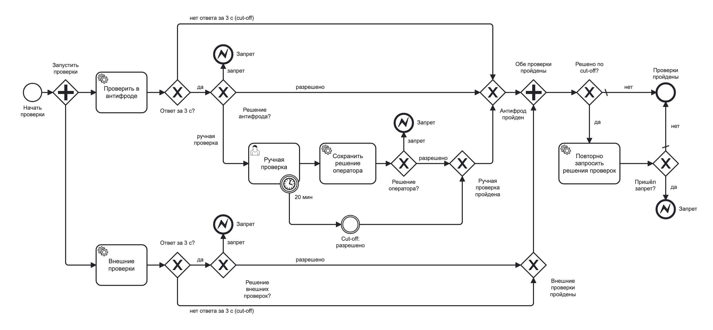
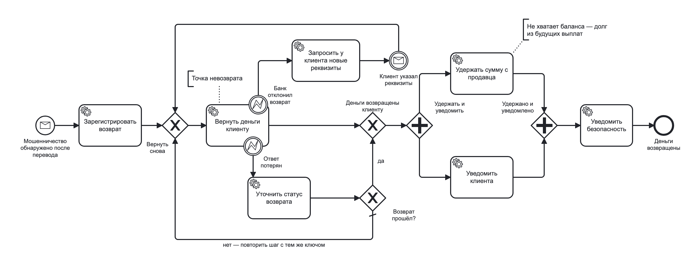

# Задание 4.1. BPMN-схема обработки платежа

Схема — [payment-process.bpmn](payment-process.bpmn), исполняемая модель для Camunda 8.5. Её же разворачивает прототип из Task4.2 (`Task4.2/process.bpmn` — побайтная копия, это проверяет тест).

## Основной процесс



- **Старт — сообщение «Платёж инициирован»** (`payment-initiated`). Его идентификатор — paymentId, поэтому повторный запрос маркетплейса не запускает второй процесс.
- **Заморозка вместо списания.** «Заморозить деньги» — компенсируемый шаг: компенсационное граничное событие связано с обработчиком «Разморозить деньги».
- **Проверки** — свёрнутый подпроцесс, его содержимое ниже. Явный запрет любой проверки выходит из подпроцесса границей «Запрет».
- **Точка невозврата** — «Списать и перевести продавцу». Перевод уходит в банк один раз: если ответ потерян, статус уточняется, повторной отправки нет.
- **Автоматический возврат денег.** Запрет проверки и однозначный отказ перевода сходятся в «Отказ»: событие компенсации «Вернуть деньги клиенту» вызывает «Разморозить деньги». Если не прошла сама заморозка, размораживать нечего, и этот путь присоединяется уже после компенсации. Дальше платёж отклоняется, клиент получает уведомление, а при подозрении на мошенничество — и служба безопасности.

## Подпроцесс «Проверки»



- Антифрод и внешние проверки (AML, лимиты, GeoRisk) идут параллельно.
- Срок ответа считает обработчик шага. Нет ответа — ветка «нет ответа за 3 с (cut-off)» вливается в «разрешено». Обоснование сроков и правил cut-off — в [Task1](../Task1/README.md#сроки-проверок-cut-off).
- Ручная проверка — задача в Tasklist с формой «Разрешить / Запретить», таймером и сроком 20 минут. Решение оператора сохраняется в FraudCheck.
- Если что-то решено по cut-off, решения проверок запрашиваются ещё раз: поздний запрет останавливает платёж до перевода.

Таймеры и cut-off ведут только к «разрешено». К компенсации ведёт только явный отказ, это тоже проверяет тест.

## Возврат постфактум



Схема — [post-factum-refund.bpmn](post-factum-refund.bpmn). Основной процесс заканчивается после перевода продавцу, поэтому запрет, пришедший позже, обрабатывает отдельный процесс. Его запускает сообщение `fraud-detected-after-transfer` с ключом корреляции paymentId и идентификатором `refund:paymentId`: второе сообщение с тем же идентификатором Zeebe отклоняет, а когда возврат зарегистрирован, новый сигнал сообщение уже не публикует.

- «Вернуть деньги клиенту» — точка невозврата этого процесса. Потерян ответ — статус уточняется. Если банк возврат не исполнил, шаг отправляет его снова с тем же ключом; после трёх таких отправок подряд открывается инцидент. Если банк возврат отклонил, повторной отправки нет: шаг берёт отказ из журнала, и процесс уходит к запросу новых реквизитов.
- Банк отклонил возврат (например, карта закрыта) — клиента просят указать новые реквизиты, процесс ждёт сообщения `refund-details-provided` по тому же paymentId и отправляет возврат новой попыткой.
- После возврата параллельно удерживается сумма с продавца и уведомляется клиент, в конце — служба безопасности. Если на балансе продавца не хватает денег, остаток записывается в долг.

Этот процесс тоже выполняет Payment Service из Task4.2, сценарии R1–R7 прогоняются на стенде.

## Как перерисовать картинки

```bash
npm install --no-save bpmn-js@18 playwright@1.64.0
node render-diagram.mjs
```
