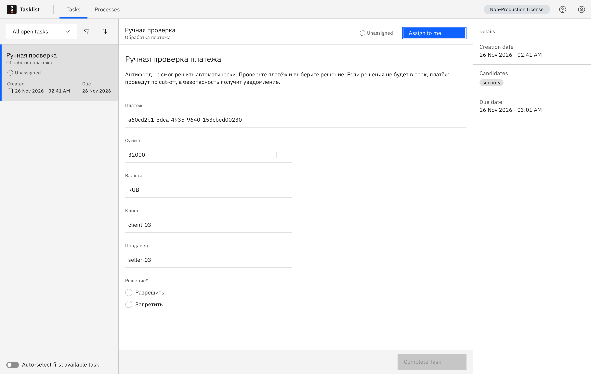
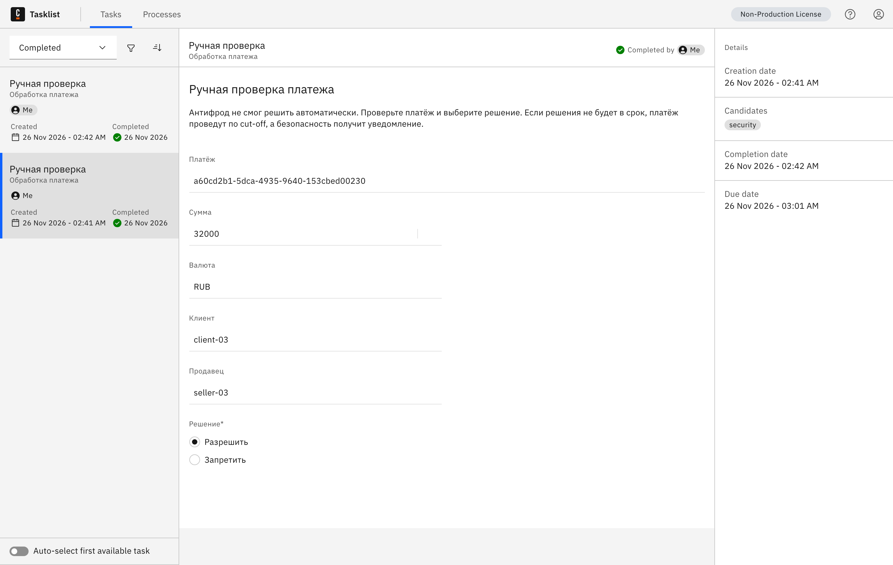
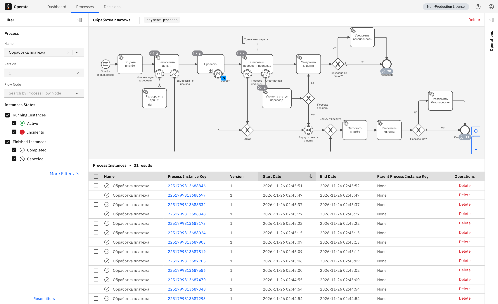
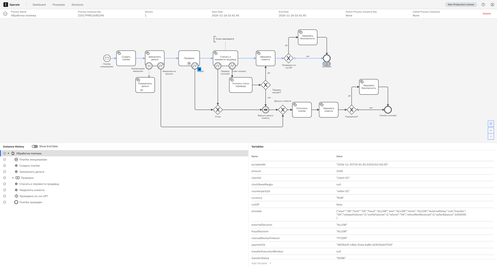
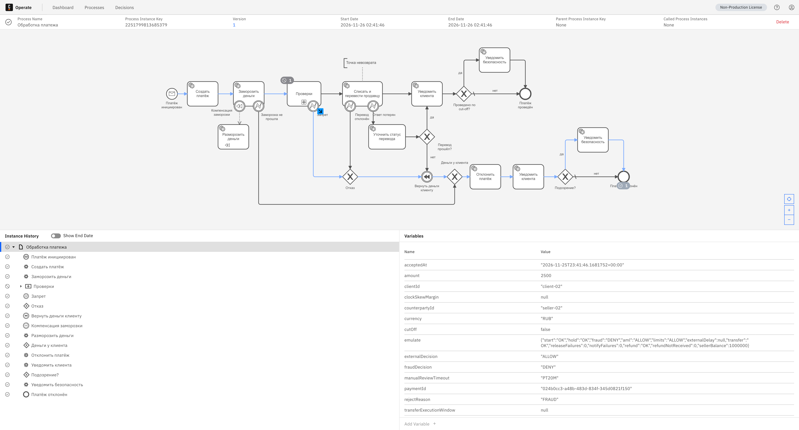
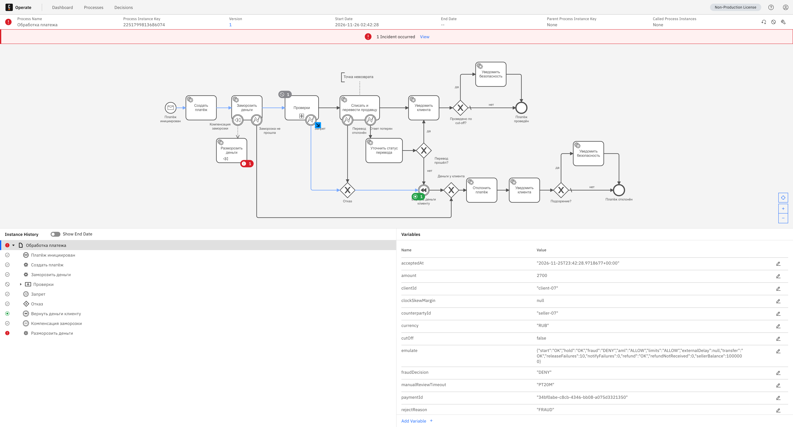
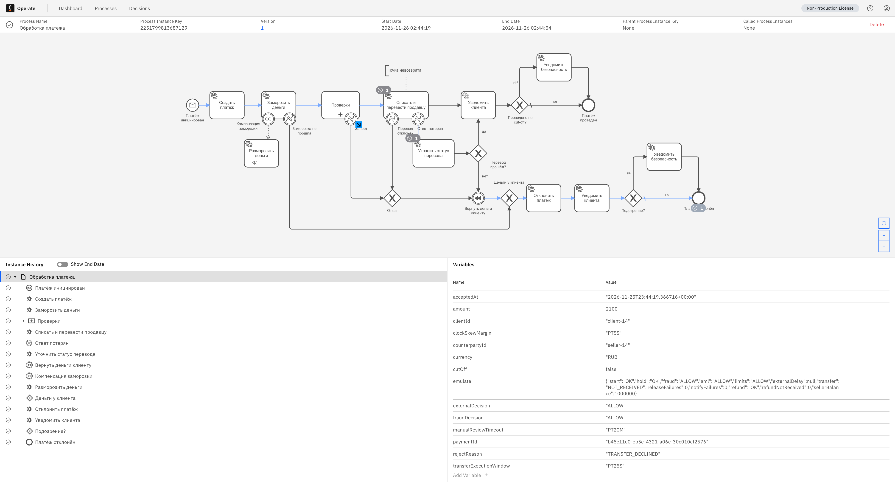
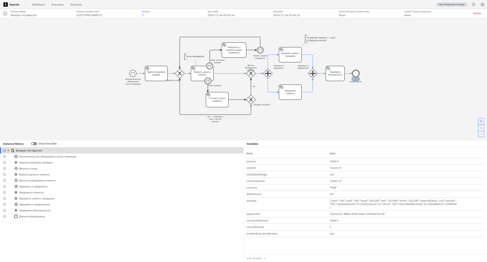
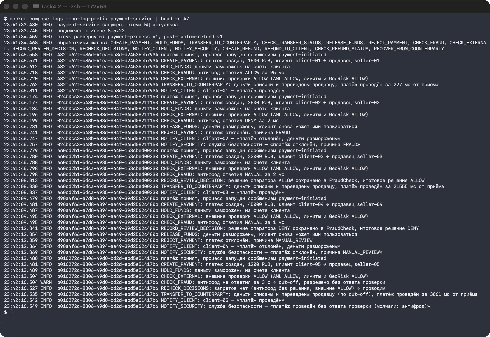

# Задание 4.2. Прототип процесса на Camunda 8

Payment Service на .NET 10 выполняет шаги двух процессов из Task4.1: `payment-process` (`process.bpmn`) и «Возврат постфактум» (`post-factum-refund.bpmn`), обе схемы — побайтные копии. Camunda (Zeebe) — оркестратор: хранит состояние процессов, считает таймеры, повторяет упавшие шаги и поднимает инциденты. Payment Service забирает задачи клиентом `zb-client`.

Стенд повторяет схему C2 выбранного варианта из [ADR](../Task3/ADR-orchestrator-placement.md): Payment Service, FraudCheck Service со своим Redis и Notification Service — отдельные сервисы, Payment Service вызывает их синхронно по HTTP и о процессе они не знают. Банк — внешняя система, в прототипе это заглушка внутри Payment Service.

## Что внутри

- `docker-compose.yml` — стенд из задания и наши сервисы: `payment-service` с PostgreSQL, `fraud-check-service` с Redis, `notification-service`.
- `src/PaymentService`: `Payments/` — платёж и возврат, их состояния и переходы, журнал денежных операций с ключом `paymentId:STEP`, заглушка банка; `Process/` — обработчики задач, запуск процесса и сообщения процессу возврата; `FraudCheck/`, `Notifications/` — HTTP-клиенты FraudCheck Service и Notification Service; `Data/Migrations/` — схема БД.
- `src/FraudCheckService`: антифрод, внешние проверки и итоговые решения по платежу, кеш AML в Redis. Правила антифрода и внешние провайдеры заменены заглушками.
- `src/NotificationService`: уведомления клиенту и безопасности, повтор с тем же ключом второй раз не отправляется. Каналы доставки заменены записью в лог.
- `tests/PaymentService.Tests` — ArchUnitNET (денежный код не зависит от Zeebe, шаги процесса работают с деньгами только через `PaymentOperations` и `RefundOperations`, FraudCheck Service и Notification Service не зависят от Zeebe), проверки схем и интеграционные тесты на PostgreSQL в Testcontainers. Вывод — `results/dotnet-test.txt`.
- `run-scenarios.sh` — прогон всех сценариев, `tools/move-to-reject.cs` — модификация экземпляра процесса для сценария 14.

API:

- `POST /payments` с обязательным заголовком `Idempotency-Key` → `202` и `paymentId`. Повтор с тем же ключом получает тот же платёж, тот же ключ с другой суммой или участниками — `422`. Если Camunda недоступна — `503`, запрос сохраняется, и повтор с тем же ключом запускает процесс с тем же `paymentId`. Ключ экземпляра процесса появляется в `GET /payments/{id}`, когда выполнен шаг «Создать платёж».
- `POST /payments/{id}/fraud-detected` — поздний сигнал о мошенничестве, запускает возврат постфактум (только для проведённого платежа). `POST /payments/{id}/refund-details` — клиент указал новые реквизиты.
- `GET /payments/{id}` — состояние платежа и возврата, журнал операций.

Что держит код:

- Процесс платежа запускается сообщением `payment-initiated`, его идентификатор — paymentId. Пока Zeebe помнит сообщение, второе с тем же идентификатором он отклоняет, а после шага «Создать платёж» повтор запроса сообщение уже не публикует. Поэтому одновременные повторы и повтор после потерянного ответа не создают второй экземпляр.
- Если дубль экземпляра всё же стартует, например после того как Zeebe забыл сообщение, шаги «Создать платёж» и «Зарегистрировать возврат» видят, что платёж или возврат уже закреплён за другим экземпляром, и открывают инцидент вместо выполнения.
- Платёж и возврат переходят только по разрешённым переходам, из `COMPLETED` и `REJECTED` выхода нет. Запись в журнал и смена состояния идут одной транзакцией.
- Перевод и возврат уходят в банк один раз. Если итог не записан, шаг только уточняет статус. «Не найден» значит «не выполнен» только после срока исполнения и запаса на расхождение часов.
- Если перевод уходил в банк, `RELEASE_FUNDS` перед разморозкой сам уточняет его итог. «Отклонён» или «не выполнен» разрешают разморозку. Пока итог неизвестен, шаг ждёт и спрашивает банк снова. Если перевод выполнен, шаг открывает инцидент.
- Возврат, который банк не исполнил, отправляется снова с тем же ключом. После трёх таких отправок подряд шаг открывает инцидент, после его устранения счёт начинается заново.
- Один возврат на платёж. Сигнал о мошенничестве публикуется сообщением с идентификатором `refund:paymentId`: одновременные сигналы запускают один возврат, а когда возврат зарегистрирован, новый сигнал сообщение не публикует.
- FraudCheck Service хранит в Redis последний результат AML-скрининга пары клиент–продавец. Он нужен, только если AML-провайдер не ответил. Лимиты и GeoRisk не кешируются. Запрет одного провайдера отклоняет платёж, даже если второй не ответил.
- Срок проверки Payment Service передаёт FraudCheck Service в заголовке `Request-Timeout-Ms`: сервис отвечает тем, что успел получить от провайдеров, чуть раньше срока. Если сервис не ответил к сроку или недоступен, это cut-off.

## Настройки и откуда числа

| Настройка | Значение | Почему |
|---|---|---|
| `Checks:Timeout` | 3 с | срок проверок, см. [Task1](../Task1/README.md#сроки-проверок-cut-off) |
| `Checks:RecheckTimeout` | 500 мс | повторный запрос только читает принятые решения; дольше — съедает остаток SLA после cut-off |
| `Transfer:ExecutionWindow` | 30 с | после этого банк перевод или возврат не исполняет; обычная операция занимает секунды |
| `Transfer:ClockSkewMargin` | 30 с | запас на расхождение часов с банком |
| `Aml:CacheTtl` (FraudCheck Service) | 24 ч | санкционные списки и списки PEP обновляются раз в сутки |
| `Redis:Timeout` (FraudCheck Service) | 300 мс | кеш читается параллельно с провайдером; медленный Redis не сдвигает срок 3 с |
| `Checks:ResponseMargin` (FraudCheck Service) | 100 мс | ответ уходит раньше срока вызывающего, чтобы успеть дойти до него по сети |
| Разморозка | 10 попыток, пауза 1 с с удвоением до 5 мин | кратковременный сбой банка переживается без людей, примерно через 8,5 минуты нужен дежурный |
| Уточнение статуса перевода и возврата | 10 попыток при сбоях | «банк ещё не нашёл операцию» до конца окна попыток не тратит |
| `Workers:CheckHandlerThreads` | 32 | молчащий провайдер держит обработчик 3 с; 32 ожидания — около 10 платежей в секунду без очереди |
| `Refund:MaxUnexecutedSends` | 3 | каждая отправка возврата ждёт срок исполнения и запас — минуту; три неисполненные подряд — уже не случайный сбой, нужен дежурный |
| `Demo:TimingOverrides` | выключено, в стенде включено | сроки из запроса нужны только сценариям стенда; сервис принимает их короче своих сроков |
| Сообщение с новыми реквизитами | живёт 1 мин | реквизиты могут прийти раньше, чем процесс начнёт их ждать |
| `Start:MessageTtl` | 24 ч | столько Zeebe помнит сообщения о старте платежа и возврата и отклоняет их повтор; дольше любого повтора запроса маркетплейса и простоя обработчиков |

## Как запустить

```bash
docker compose up -d
bash run-scenarios.sh      # нужны curl, jq и .NET SDK 10; прогон занимает около шести минут
docker compose stop
```

Operate — http://localhost:8081, Tasklist — http://localhost:8082 (demo/demo). Тесты: `dotnet test PaymentService.slnx` (нужен Docker).

Payment Service сам разворачивает обе схемы при запуске и до этого отвечает на запросы `503`: сообщение о старте, опубликованное раньше схемы, к ней уже не привяжется. `deploy-process` взят из задания без изменений и разворачивает `process.bpmn`. `run-scenarios.sh` разворачивает обе схемы ещё раз, чтобы записать ответ Zeebe в `results/deploy.txt`. Сервис и `zbctl` разворачивают схемы под одними именами ресурсов, поэтому вторая версия не появляется: в `deploy.txt` версия 1.

## Сценарии

`bash run-scenarios.sh` прогоняет сценарии по очереди и пишет итоги в `results/scenarios.txt`. Ключи и время — из последнего прогона на чистом стенде.

| № | Сценарий | Путь в процессе | Итог |
|---|---|---|---|
| 1 | успех: проверки разрешили | обе проверки «разрешено» → перевод → уведомление клиенту | COMPLETED, 226 мс, `2251799813685290` |
| 2 | запрет антифрода | «Запрет» → «Вернуть деньги клиенту» вызывает «Разморозить деньги» → отклонение → уведомления клиенту и безопасности | REJECTED, FRAUD, 72 мс, `2251799813685379` |
| 3 | ручная проверка: разрешено | задача в Tasklist, demo выбирает «Разрешить» → «Сохранить решение оператора» → перевод | COMPLETED, 21554 мс, `2251799813685481` |
| 4 | ручная проверка: запрет | «Запретить» → «Решение оператора?» запрет → компенсация | REJECTED, MANUAL_REVIEW, 2884 мс, `2251799813685617` |
| 5 | антифрод молчит: cut-off 3 с | «нет ответа за 3 с (cut-off)» → `CUT_OFF_APPROVED` → повторный запрос решений → перевод → уведомление безопасности | COMPLETED, по cut-off, 3060 мс, `2251799813685732` |
| 5a | оператор молчит: cut-off ручной проверки | таймер ручной проверки (в демо 10 с) → «Cut-off: разрешено» → повторный запрос → перевод → уведомление безопасности | COMPLETED, по cut-off, 10433 мс, `2251799813685848` |
| 6 | ответ о переводе потерян | «Ответ потерян» → «Уточнить статус перевода»: банк сначала перевод не нашёл, через секунду — «прошёл» | COMPLETED, 1174 мс, `2251799813685976` |
| 7 | разморозка не проходит → инцидент → повтор | запрет антифрода → «Разморозить деньги» 10 попыток с растущей паузой → инцидент в Operate → `zbctl update retries` и `zbctl resolve incident` → разморозка | REJECTED, FRAUD, 59424 мс, `2251799813686074` |
| 8a | AML: первый платёж пары, результат в кеше | AML-скрининг у провайдера, результат сохранён в Redis | COMPLETED, 27 мс, `2251799813686274` |
| 8b | AML-провайдер молчит, лимиты и GeoRisk ответили | лимиты и GeoRisk ответили, AML — последний результат из кеша, без cut-off | COMPLETED, 2939 мс, `2251799813686363` |
| 8c | лимиты и GeoRisk молчат, AML есть в кеше | AML есть в кеше, но лимиты не ответили → cut-off → повторный запрос → уведомление безопасности | COMPLETED, по cut-off, 2947 мс, `2251799813686452` |
| 8d | AML запретил, лимиты и GeoRisk молчат | AML-провайдер запретил платёж, лимиты и GeoRisk не ответили за 3 с: запрет побеждает cut-off → компенсация → уведомления клиенту и безопасности | REJECTED, EXTERNAL, 2844 мс, `2251799813686568` |
| 9 | Redis остановлен | контейнер Redis FraudCheck Service остановлен: кеш недоступен (в логе FraudCheck), AML и лимиты ответил провайдер | COMPLETED, 28 мс, `2251799813686670` |
| 10 | пять одновременных запросов с одним ключом | пять одновременных `POST /payments` с одним ключом: один paymentId, Zeebe принял одно сообщение о старте, экземпляр процесса один | COMPLETED, 39 мс, `2251799813686759` |
| 11 | тот же ключ, другая сумма | `POST /payments` с ключом из сценария 10 и другой суммой | `422`, процесс не создан |
| 12 | Camunda недоступна: 503, повтор с тем же ключом | контейнер Zeebe остановлен: `POST /payments` → `503`, запрос сохранён; Zeebe запущен, повтор с тем же ключом запустил процесс с тем же paymentId | COMPLETED, 166 мс, `2251799813686865` |
| 12a | ответ Zeebe о старте потерян, повтор с тем же ключом | Zeebe принял сообщение о старте, но ответ до сервиса не дошёл (заглушка) → `503`; повтор с тем же ключом → `202`, тот же paymentId, Zeebe отклонил повтор сообщения, экземпляр один | COMPLETED, 41 мс, `2251799813686969` |
| 13 | ответ о заморозке потерян | ответ банка о заморозке потерян → заморозка отменена тем же ключом → отказ; поздний запрос заморозки с этим ключом банк отклонил (в логе) | REJECTED, HOLD_NOT_CONFIRMED, 30 мс, `2251799813687074` |
| 14 | защита разморозки: перевод мог пройти | ответ о переводе потерян, банк перевод не получил (в демо окно 25 с и запас 5 с); токен вручную переведён в путь отказа → «Разморозить деньги» уточняет итог перевода в банке и ждёт, пока он неизвестен → после срока банк перевод не нашёл: не выполнен → разморозка → отклонение | REJECTED, TRANSFER_DECLINED, 34807 мс, `2251799813687129` |
| 15 | не хватает денег | «Заморозка не прошла» → отклонение, проверки не запускались | REJECTED, INSUFFICIENT_FUNDS, 25 мс, `2251799813687293` |
| 16 | банк отклонил перевод | «Перевод отклонён» → компенсация → отклонение | REJECTED, TRANSFER_DECLINED, 45 мс, `2251799813687348` |
| 17 | перевод не найден после окна и запаса | «Ответ потерян» → банк не находит перевод и после окна с запасом (в демо по 2 с) → не выполнен → компенсация | REJECTED, TRANSFER_DECLINED, 5180 мс, `2251799813687470` |
| 18 | запрет внешних проверок снимает ручную проверку | антифрод отправил на ручную проверку, внешние проверки запретили → задача оператора снята → компенсация | REJECTED, EXTERNAL, 2051 мс, `2251799813687586` |
| 19 | поздний запрет антифрода после cut-off | антифрод не ответил за 3 с, но сохранил запрет → повторный запрос решений нашёл запрет → компенсация | REJECTED, FRAUD, по cut-off, 3056 мс, `2251799813687705` |
| 20 | уведомление не прошло дважды | Notification Service дважды ответил 503, уведомление прошло с третьей попытки | COMPLETED, 26 мс, `2251799813687819` |
| 21 | FraudCheck Service остановлен: проверки по cut-off | контейнер FraudCheck Service остановлен: обе проверки без ответа за 3 с → cut-off → повторный запрос решений без ответа → перевод → уведомление безопасности | COMPLETED, по cut-off, 3547 мс, `2251799813687903` |
| R1 | возврат, сумма удержана с продавца | `POST /payments/{id}/fraud-detected` → «Зарегистрировать возврат» → «Вернуть деньги клиенту» → удержание с продавца ‖ уведомление клиенту → уведомление безопасности | REFUNDED / RECOVERED (удержано 1500.00, долг 0.00), `2251799813688113` |
| R2 | ответ о возврате потерян | «Ответ потерян» → «Уточнить статус возврата» → возврат прошёл, повторного возврата нет | REFUNDED / RECOVERED (удержано 1600.00, долг 0.00), `2251799813688262` |
| R3 | банк отклонил возврат, новые реквизиты | банк отклонил возврат → клиенту запрос новых реквизитов → `POST /payments/{id}/refund-details` → возврат прошёл | REFUNDED / RECOVERED (удержано 1700.00, долг 0.00), `2251799813688437` |
| R4 | на балансе продавца не хватило | на балансе продавца меньше суммы возврата → удержано, что было, остаток записан в долг | REFUNDED / DEBT_RECORDED (удержано 500.00, долг 1000.00), `2251799813688786` |
| R5 | повторный сигнал, пока возврат идёт | второй сигнал о мошенничестве, пока возврат ждёт реквизиты | экземпляр возврата один, `2251799813688437` |
| R6 | три одновременных сигнала о мошенничестве | три одновременных `POST /payments/{id}/fraud-detected`: Zeebe принял одно сообщение, экземпляр возврата один, возврат в журнале один | экземпляр возврата один, возврат один, `2251799813688621` |
| R7 | банк трижды не исполнил возврат → инцидент → повтор | три отправки возврата не дошли до банка (в демо окно и запас по 2 с) → после третьей «Уточнить статус возврата» открывает инцидент → `zbctl update retries` и `zbctl resolve incident` → четвёртая отправка с тем же ключом прошла | REFUNDED / RECOVERED (удержано 1650.00, долг 0.00), `2251799813688935` |

## Скриншоты

Ручная проверка в Tasklist, срок задачи — 20 минут:



Завершённые задачи ручной проверки:



Operate, все прогоны:



Успешный платёж:



Запрет антифрода — в истории компенсация «Вернуть деньги клиенту» → «Разморозить деньги»:



Инцидент на разморозке — банк не отвечает, попытки кончились:



Защита разморозки — перевод уходил в банк, и «Разморозить деньги» разморозил их, только когда банк подтвердил, что перевод не выполнен:



Возврат постфактум выполнен:



Начало лога Payment Service — сценарии 1–5: успех, запрет антифрода, ручная проверка с разрешением и с запретом, cut-off. Полный лог — `results/service-log.txt`, логи FraudCheck Service и Notification Service — `results/fraud-check-log.txt` и `results/notification-log.txt`:



## Ограничения

- Банк — заглушка внутри Payment Service за интерфейсом `IBank`. В FraudCheck Service заглушки заменяют правила антифрода и внешних провайдеров, в Notification Service — каналы доставки. Их поведение задаёт поле `emulate` запроса платежа, и отвечают они сразу. Поэтому время успешного платежа в сценарии 1 — это накладные расходы Camunda, сети между сервисами и обработчиков, а не доказательство SLA: время ответа банка и настоящих провайдеров здесь не учтено.
- В демо сокращены сроки: ручная проверка в сценарии 5a — 10 с, окно и запас перевода в сценарии 17 — по 2 с, в сценарии 14 — 25 с и 5 с, окно и запас возврата в сценарии R7 — по 2 с (поля `manualReviewTimeout`, `transferExecutionWindow`, `clockSkewMargin` запроса), пауза между повторами — до 4 с (`Retries__MaxBackoff`). Поля со сроками сервис принимает, только если включена настройка `Demo__TimingOverrides`, и только короче своих сроков; иначе запрос получает `400`.
- Сценарий 14 доводит процесс до состояния, в которое схема сама не приходит: токен переводится в путь отказа модификацией экземпляра, пока итог перевода неизвестен. Так проверяется, что сервис и тогда не разморозит деньги, пока банк не ответит однозначно.
- FraudCheck Service хранит итоговые решения по платежам, а Notification Service — ключи отправленных уведомлений в памяти: после перезапуска они теряются. В рабочих сервисах это их собственные хранилища.
- Статус `APPROVED` выставляет шаг перевода перед отправкой в банк: отдельного шага между проверками и переводом в схеме нет.
- Долг продавца записывается, но его погашение из будущих выплат в прототип не входит.
